# 02 — Data Model (rev 2)

Conventions:
- `uuid` PKs (`gen_random_uuid()`, or a client-generated id where offline creation is needed)
- `created_at` / `updated_at timestamptz`
- soft delete only where audit requires it
- all money is `numeric(12,2)` plus a `currency char(3)`
- all instants are `timestamptz` plus an IANA `timezone` text on the owning entity
- `country_code char(2)` on events, organisations and regions (expansion-ready)

## ERD (core)

```mermaid
erDiagram
  auth_users ||--|| profiles : has
  profiles ||--o{ user_roles : has
  profiles ||--o{ organisation_members : "member of"
  organisations ||--o{ organisation_members : has
  organisations ||--o{ events : owns
  events ||--o{ event_members : "co-organisers"
  profiles ||--o{ event_members : ""
  events ||--o{ event_distances : offers
  events ||--o{ event_media : has
  events ||--o{ event_sponsors : has
  regions ||--o{ events : "located in"
  countries ||--o{ regions : has
  profiles ||--o{ rsvps : makes
  events ||--o{ rsvps : receives
  profiles ||--o{ event_follows : follows
  profiles ||--o{ check_ins : makes
  events ||--o{ check_ins : receives
  profiles ||--o{ runs : records
  runs }o--o| check_ins : "linked to"
  runs ||--o| community_results : "shared as"
  events ||--o{ community_results : board
  community_results ||--o{ reports : reported
  profiles ||--o{ blocks : blocks
  profiles ||--o{ push_tokens : has
  profiles ||--|| notification_prefs : has
  profiles ||--o{ organiser_mutes : mutes
  plans ||--o{ plan_features : defines
  features ||--o{ plan_features : ""
  plans ||--o{ entitlement_grants : grants
  profiles ||--o{ entitlement_grants : "participant grants"
  events ||--o{ entitlement_grants : "listing grants"
  organisations ||--o{ payment_intents : pays
  payment_intents ||--o{ payment_proofs : has
  payment_intents ||--o| invoices : invoiced
  events ||--o{ event_stats_daily : aggregates
  clubs ||--o{ club_members : has
  profiles ||--o{ follows : "follower"
  profiles ||--o{ follows : "followee"
  profiles ||--o| profile_private : has
  profiles ||--|| audit_actor_aliases : pseudonym
  profiles ||--o{ club_members : joins
```

## Tables

### Identity & roles
| Table | Key columns | Notes |
|---|---|---|
| `profiles` | `id` (= auth.users.id), `display_name`, `nickname`, `date_of_birth date NOT NULL`, `home_region_id`, `weight_kg numeric(5,1) NULL`, `health_consent_at`, `account_privacy` (`private` default / `public`), `show_attendance_to_clubs bool default false`, `country_code`, `timezone`, `created_at` | **Hard rule:** trigger rejects any insert/update where age < 18 (pgTAP-tested). Created only through `complete_signup` |
| `profile_private` | `user_id`, `emergency_contact_ciphertext text`, `key_version smallint` | Owner-only RLS; no admin policy. Encrypted in the Edge Function (F5) |
| `user_roles` | `user_id`, `role app_role`, `granted_at` | PK (user_id, role). Only Super Admin at `aal2` can insert/delete `platform_admin`. Who granted it is recorded in the audit log via alias |
| `consents` | `user_id`, `kind` (`location`, `health_data`, `public_sharing`, `marketing_push`, `terms`, `privacy`), `version`, `granted_at`, `revoked_at` | Evidence for DPA / store forms |

### Geography & config
| Table | Notes |
|---|---|
| `countries` | `code`, `name`, `currency`, `default_timezone`, `active`. Seed: TT only active |
| `regions` | `id`, `country_code`, `name`, `kind` (`area`/`corporation`), `parent_id`, `sort` |
| `app_settings` | single-row-per-key JSONB: `checkin_radius_m`, `checkin_window_before_min`, `checkin_window_after_min`, `pace_limit_sec_per_km` (155), `free_alert_filter_limit`, `community_disclaimer_text`, legal text versions… Admin-editable, audited |
| `legal_documents` | `kind`, `version`, `body_md`, `published_at` — served at `/legal/*` |
| `announcements` | platform-wide messages + push |

### Organisers & events
| Table | Key columns / notes |
|---|---|
| `organisations` | `name`, `slug`, `contact_email`, `contact_phone`, `country_code`, `timezone`, `currency`, `status` (`applied`,`verified`,`rejected`,`suspended`), `verified_by`, `rejection_reason` |
| `organisation_members` | `organisation_id`, `user_id`, `role` (`owner`,`manager`) |
| `organiser_applications` | applicant details, ID/document upload refs, 18+ check result, review fields |
| `events` | `organisation_id`, `slug`, `name`, `description`, `starts_at timestamptz`, `timezone`, `country_code`, `region_id`, `venue_name`, `start_location geography(Point)`, `route_polyline NULL`, `registration_url NULL`, `registration_instructions`, `package_collection`, `parking`, `contact_*`, `cause`, `charity_name`, `walk_friendly bool`, `fee_min`, `fee_max`, `currency`, `status` (`draft`,`pending_approval`,`published`,`postponed`,`cancelled`,`unpublished`,`rejected`), `featured_until`, `checkin_radius_m NULL`, `checkin_opens_at`/`closes_at NULL` (overrides), `duplicated_from_id`, `published_at`, `approved_by` |
| *RunLime listings (owner decision 2026-10-15)* | Events the admin enters from public facts before organisers join. **Phase 2 migration:** `organisation_id` becomes nullable and a new column `listing_source` (`organiser` default / `runlime`) is added. CHECK: `organiser` ⇒ `organisation_id NOT NULL`; `runlime` ⇒ `organisation_id IS NULL` **and** `registration_url NOT NULL` (the official link). A trigger rejects `event_media` and `event_sponsors` rows for `runlime` listings (no flyers or logos without permission). Public pages show the notice from setting `events.unaffiliated_notice`. An organiser who later joins can claim the listing (admin moves it to their organisation; `listing_source` → `organiser`) |
| `event_distances` | `event_id`, `distance_km numeric(5,2)`, `label` ("5K", "10K", "2K fun walk") |
| `event_members` | per-event co-organisers: `event_id`, `user_id`, `role` (`co_organiser`), `invited_by`, `accepted_at` |
| `event_media` | `kind` (`flyer`,`route_map`,`gallery`), `storage_path`, `alt_text` (required — accessibility) |
| `event_sponsors` | `name`, `logo_path`, `url`, `sort` |
| `event_changes` | change history used for "what changed" notifications |
| `race_suggestions` | user-submitted missing races; `status`, `converted_event_id` |
| `duplicate_candidates` | populated by a trigger: same region ± 1 day, trigram name similarity > 0.6 → flagged in the admin queue |

### Participation
| Table | Key columns / notes |
|---|---|
| `rsvps` | `user_id`, `event_id`, `status` (`attending`,`maybe`,`not_attending`), `group_size smallint CHECK 1..20` (adults incl. the user), `children_count smallint CHECK 0..20` (under-18s attending with the group), `updated_at`. PK (user_id, event_id) |
| `rsvp_history` | append-only, for the organiser trend chart (aggregated nightly to `event_stats_daily`) |
| `event_follows` | implicit when RSVP is attending/maybe; explicit "follow" too |
| `check_ins` | `user_id`, `event_id`, `method` (`gps` only in v1), `lat/lng rounded to 3 dp`, `accuracy_m`, `checked_in_at`. UNIQUE (user_id, event_id). Insert only via RPC |
| `clubs`, `club_members` | Admin-created clubs (screen A14); users join/leave; `show_attendance_to_clubs` opt-in |
| `follows` | `follower_id`, `followee_id`, `status` (`pending`,`accepted`), `created_at`, `accepted_at`. PK (follower, followee). Insert = `accepted` if the followee is public, else `pending`. Either side can delete. Blocking deletes both directions |
| `event_stats_daily` | `event_id`, `date`, `attending`, `maybe`, `not_attending`, `group_total`, `children_total`, `views`, `shares`, `calendar_adds`, `checkins`, `by_region jsonb` |
| `event_counters` | live counters updated by triggers (fast public "N attending") |

### Runs & community
| Table | Key columns / notes |
|---|---|
| `runs` | `id` (client uuid), `user_id`, `started_at`, `ended_at`, `moving_seconds`, `elapsed_seconds`, `distance_m`, `avg_pace_sec_per_km`, `splits jsonb`, `steps NULL`, `calories_est NULL`, `route_polyline NULL`, `source` (`tracked`,`typed_in`), `event_id NULL`, `check_in_id NULL`, `device_meta jsonb`. Private: RLS owner-only |
| `personal_bests` | materialised per (user, distance bucket 5K/10K/HM/M) — recomputed on run upsert |
| `community_results` | `event_id`, `run_id`, `user_id`, `display_name_snapshot` (display name or nickname, the user's choice), `time_seconds`, `distance_km`, `source` (`tracked`/`typed_in`), `status` (`visible`,`withdrawn`,`removed`), `shared_at`. CHECK via trigger: user has a check-in for the event, pace ≥ the setting, one per user per event |
| `reports` | polymorphic: `target_type` (`community_result`,`event`,`profile`), `target_id`, `reporter_id`, `reason`, `details`, `status`, `resolved_by`, `resolution` |
| `blocks` | `blocker_id`, `blocked_id` — removes follows both ways, prevents new follow requests, hides each user's content from the other |
| `moderation_actions` | `target_user_id`, `action` (`warn`,`suspend`,`remove_content`,`exclude_from_leaderboards`), `reason`, `until`, `actor_id` |

### Activity leaderboards (Phase 6, owner decision 2026-10-15)
Two boards: **Kilometres** (tracked runs) and **Races attended** (GPS check-ins). Periods: **Weekly** (Mon–Sun), **Monthly**, **Year** (calendar periods in the user's country time zone, America/Port_of_Spain for TT). Scopes: **Everyone** and **People I follow**. Shows the top N (setting, 20) plus the viewer's own rank. Opt-in only; no prizes.

| Table / column | Notes |
|---|---|
| `profiles.leaderboard_opt_in boolean default false`, `leaderboard_name` (`display_name`/`nickname`) | Off by default for everyone. Turning it on records a `consents` row (kind `leaderboards`). Turning it off removes the user from every board at once |
| `leaderboard_totals` | `user_id`, `board` (`km`,`races`), `period` (`week`,`month`,`year`), `period_start date`, `value numeric(10,2)`, `updated_at`. PK (user_id, board, period, period_start). Recomputed for one user on run insert/update/delete and on check-in, plus a nightly pg_cron rebuild. **No direct read access (RLS: none)**; read only through the RPC below |
| RPC `leaderboard(board, period, scope)` | `SECURITY DEFINER`. Returns the top N + the caller's row with rank (competition ranking: 1, 2, 2, 4). Includes only opted-in users who are not suspended, not excluded by moderation, and not blocked by or blocking the viewer. `following` scope = accepted follows of the caller + the caller. Returns name, rank and value only, never routes, run times or areas |

**Verified data only:**
- **Kilometres:** only `runs.source = 'tracked'` (recorded by the app's GPS tracker). Typed-in times never count. A run is excluded if its average pace is faster than `leaderboard.min_pace_sec_per_km`, or any 1 km split is faster than that limit (impossible speed: car, bike, GPS jump). A run longer than `leaderboard.max_run_km` is excluded too.
- **Races attended:** count of the user's GPS `check_ins` in the period (one per event, by design).
- Limit (stated in the in-app disclaimer): tracked runs come from the user's phone, so a determined user could fake GPS. The server checks above remove impossible values; reports and the admin `exclude_from_leaderboards` action handle the rest.

**Settings (admin-editable, never hardcoded):** `leaderboard.enabled` (bool), `leaderboard.size` (20), `leaderboard.min_pace_sec_per_km` (155 = 2:35 /km), `leaderboard.max_run_km` (100), `leaderboard.disclaimer` ("Just for fun. Based on runs tracked in RunLime and GPS race check-ins. No prizes.").

### Notifications
| Table | Notes |
|---|---|
| `push_tokens` | `user_id`, `expo_token`, `platform`, `last_seen_at`, `disabled_at` |
| `notification_prefs` | `areas uuid[]`, `distances numeric[]`, `types text[]` (`new_race`,`reminder`,`change`,`announcement`), `quiet_start/quiet_end time`, `timezone`, `reminder_offsets` |
| `organiser_mutes` | `user_id`, `organisation_id` |
| `notification_jobs` | `kind`, `event_id`, `payload`, `status`, `scheduled_for`, `attempts` |
| `notification_deliveries` | `job_id`, `user_id`, `ticket_id`, `receipt_status` (90-day retention) |
| `broadcasts` | organiser-sent messages; `kind` (`promo`,`update`), counted against the plan |

### Plans, entitlements, payments
| Table | Notes |
|---|---|
| `features` | `key` (e.g. `alerts.filter_limit`, `history.full`, `history.yoy`, `card.styles`, `event.broadcasts`, `event.featured`), `value_type` (`bool`,`int`) |
| `plans` | `key` (`participant_free`, `participant_premium`, `organiser_basic`, `organiser_featured`), `audience` (`participant`/`event`), `price`, `currency`, `period` (`month`,`year`,`per_event`), `store_product_ids jsonb`, `active` |
| `plan_features` | `plan_id`, `feature_key`, `value jsonb` — edit to move a feature between free and paid, no code change |
| `entitlement_grants` | `subject_type` (`user`,`event`,`organisation`), `subject_id`, `plan_id`, `source` (`store_apple`,`store_google`,`bank_transfer`,`admin_grant`), `starts_at`, `ends_at`, `external_ref`, `revoked_at` |
| `store_events` | raw RevenueCat webhook payloads (idempotency key = event id) |
| `payment_intents` | `organisation_id`, `payer_alias` (not a user id; survives account deletion for 7-year retention), `event_id NULL`, `plan_id`, `amount`, `currency`, `provider`, `reference` (unique, human-friendly e.g. `RL-7K3Q-92`), `status` (`awaiting_payment`,`proof_submitted`,`paid`,`rejected`,`expired`) |
| `payment_proofs` | `payment_intent_id`, `storage_path`, `uploaded_by`, `note` |
| `invoices` | `number`, `payment_intent_id`, `issued_at`, `pdf_path`, tax fields |

Resolving entitlements: SQL function `has_feature(subject, feature_key)` / `feature_value(...)` = the most generous value across active grants, falling back to the free plan's value. The same logic lives in TS (`resolveEntitlements`) for UI display; the server decides.

### Support & audit
| Table | Notes |
|---|---|
| `support_tickets` | `user_id NULL`, `email`, `kind` (`contact`,`feedback`,`bug`), `body`, `status`, `assigned_to` |
| `support_messages` | thread replies |
| `audit_actor_aliases` | `user_id` PK (→ auth.users ON DELETE CASCADE), `alias uuid` | Deleted with the account, which makes audit entries unlinkable (F3) |
| `audit_log` | `actor_alias`, `actor_roles text[]`, `action`, `table_name`, `row_id` (or `subject_alias` for person-keyed tables), `before jsonb`, `after jsonb` (allowlisted columns only), `at`. Append-only, no IP |
| `rate_limits` | `bucket`, `subject`, `window_start`, `count` |

## Age rule (hard)
`profiles` trigger `enforce_adult()` raises if `date_of_birth > current_date - interval '18 years'`. It runs on INSERT and UPDATE of `date_of_birth`. It is not configurable and has no setting.

## RLS summary (enforced in Postgres, tested with pgTAP)

| Resource | Participant | Organiser | Platform Admin | Super Admin | anon |
|---|---|---|---|---|---|
| Published events | read | read; write own org's / co-organised | read/write all, approve | all | read |
| Draft/pending events | — | own org only | all | all | — |
| `rsvps` | own row CRUD | **aggregates only** via `event_counters` / views (+ nicknames of attendees who opted in) | aggregates | aggregates + support lookup | public count only |
| `runs` | own only | — | — (no access to private runs) | — | — |
| `community_results` | read visible (minus blocked users); write own via RPC | read for own events | moderate | moderate | read visible |
| `leaderboard_totals` | via `leaderboard()` RPC only (opted-in users, minus blocked) | same as participant | via RPC + moderation view | same | — |
| `check_ins` | own; insert via RPC | count for own events | read | read | — |
| `profiles` | own; others: display name/nickname/area only; passport + attending races if the owner is public or the viewer is an accepted follower, and neither has blocked the other | nickname of opted-in attendees only | read (no DOB in UI except age-verified flag) | read | — |
| `profile_private` | own only | — | — | — | — |
| `follows` | own rows (as follower or followee) | — | read (moderation) | read | — |
| `payment_*`, `invoices` | — | own org | read/update status | all | — |
| `app_settings`, `plans`, `plan_features` | read public keys | read | update (audited) | all | read public keys |
| `user_roles` | read own | read own | read; cannot grant admin (all admin rights need `aal2`) | grant/revoke at `aal2` | — |
| `audit_log` | — | own actions | read | read | — |

## Seed data (Phase 1)

- One account per role: `super@`, `admin@`, `organiser@` (verified org), `organiser.pending@` (application pending), `runner@` and `runner.public@` (public account), all on the `runlime.test` domain. The super/admin seeds come with TOTP secrets printed by the seed script for local login.
- **Blocked-under-18 path**: no account. Covered by tests: device gate unit test, a hook rejection test, a profile-trigger rejection test, and a `complete_signup` under-18 test that also asserts nothing was stored.
- ~20 realistic T&T events across areas, using dates relative to "today" so the seed never goes stale:
  - Queen's Park Savannah 5K
  - Chaguaramas Boardwalk 5K
  - San Fernando Hill Run
  - Arima Velodrome Fun Run
  - Pigeon Point (Tobago) Sunrise 5K
  - Couva Charity Walk/Run
  - Point Fortin Borough Day 5K
- Some events are postponed or cancelled, some are past (to exercise check-ins, history and the community board). All are clearly marked as SAMPLE data and the seed runs only outside production. Event names are generic/fictional so they don't imply endorsement by real organisers.
